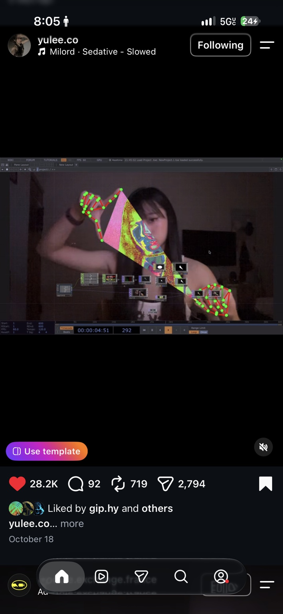
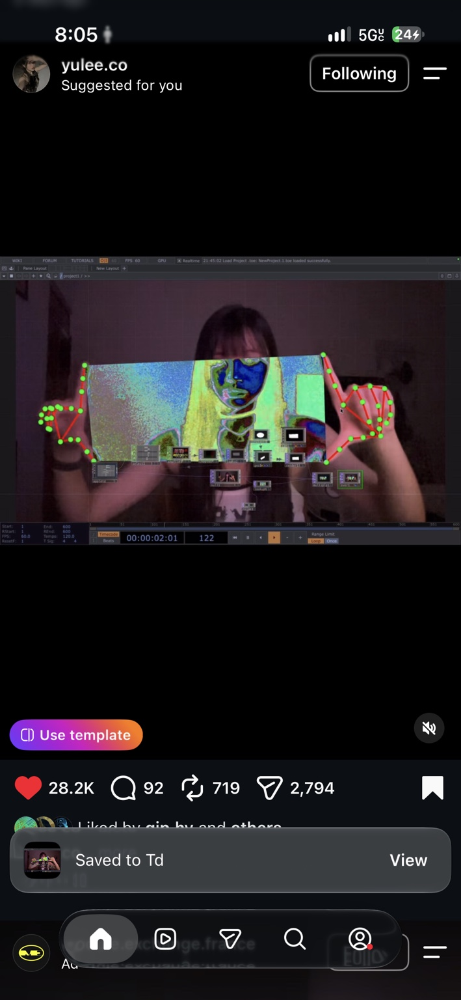
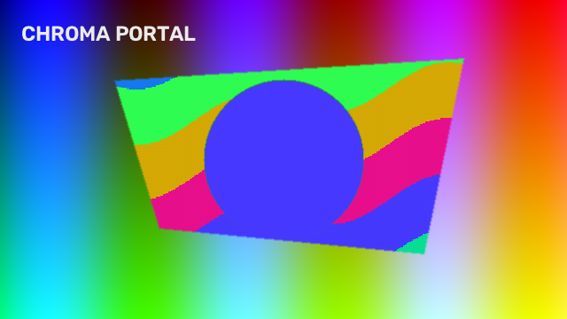
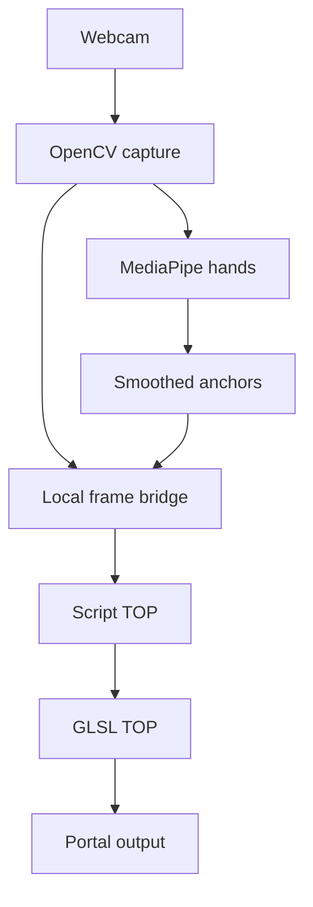

# Chroma Portal

**Stretch a psychedelic window between your hands.**

A new creative-coding project by **Kidist “Kiki” Wosenyeleh / xidist**: OpenCV captures a webcam, MediaPipe tracks both hands, and four fingertip anchors reveal animated false-color imagery inside a moving polygon. The surrounding image stays aligned and unchanged.

**Status: 0.1 starter implementation.** Includes a runnable Python preview, a local frame bridge, and a TouchDesigner GLSL shader. The geometry, compositor, bridge, and shader have automated checks. Live webcam use and the assembled TouchDesigner network still need testing on the artist's machine. No `.toe` or `.tox` binary is included yet.

## Visual inspiration and credit

Reference creator: **[@yulee.co on Instagram](https://www.instagram.com/yulee.co/)**.

These are the two reference screenshots supplied for this project, showing the creator's hand-controlled visual effect. They are **inspiration images, not output from Chroma Portal**. This repository contains an independent implementation; it does not contain the creator's patch or source code.

**Original post permalink: pending.** The screenshots show the account name and October 18, but no reel URL or year. The links below currently open the creator's profile. Replace them with the exact Instagram share link when supplied; do not mistake the profile for the original post.

<p>
  <a href="https://www.instagram.com/yulee.co/"></a>
  <a href="https://www.instagram.com/yulee.co/"></a>
</p>

Reference imagery belongs to its respective creator/rightsholders; it is not offered as an original project asset or included in any code license.

## Implemented

- Two-hand tracking using MediaPipe's Hand Landmarker Tasks API.
- Index tips (8) and thumb tips (4) control the window's four corners.
- Time-based coordinate smoothing and fade after hand-tracking loss.
- Convexity/area checks hide collapsed, crossed, or overlapping-hand shapes.
- Animated posterized cosine palette, image-edge accents, and inward feathering.
- Screen-left/right ordering independent of detection-list order.
- A standalone OpenCV preview, plus optional OSC control output.
- A loopback bridge that sends matching camera pixels and uniforms to TouchDesigner. Only Python opens the camera.
- TouchDesigner receiver timeout: a stalled bridge fades the effect instead of leaving it stuck on.

## Start the Python preview

Use **Python 3.11 or 3.12**, preferably in a fresh virtual environment. Run from the repository root.

```sh
python -m venv .venv
# macOS / Linux:
source .venv/bin/activate
# Windows PowerShell instead: .\.venv\Scripts\Activate.ps1

python -m pip install -e .
python tools/download_model.py
chroma-portal
```

The model downloader uses Google's official versioned model URL and prints its SHA-256. The model is ignored by Git and is not redistributed here. Its upstream terms apply.

Hold both hands in view, with thumb and index tips separated. Move them apart, tilt them, and change the window shape. **Q / Escape** closes the preview; **Ctrl+C** also stops it. Try `--camera 1` if the wrong camera opens. Mirroring is enabled by default; use `--no-mirror` for an unmirrored source.

```sh
# Deterministic render without a webcam or downloaded model:
chroma-portal --demo docs/demo-synthetic.png

# Feed the same frame + tracking state to TouchDesigner:
chroma-portal --bridge --no-preview

# Optional additional controls, via OSC to localhost:8000:
chroma-portal --osc
```

The app processes frames locally. The optional bridge binds **127.0.0.1** and is intended only for apps on the same machine. It does not record camera footage. Stop the app to stop capture and close the bridge.

## Synthetic implementation preview



This image is generated from gradients and shapes by our code. It demonstrates the mask and palette only; it is not a claim of verified live hand tracking.

## TouchDesigner

See **[the setup guide](touchdesigner/SETUP.md)** for the Script TOP receiver, shader input, uniform mapping, and shutdown steps. Keep the timeline playing and the output viewed while testing.



| File | Purpose |
| --- | --- |
| `src/chroma_portal/core.py` | Geometry, smoothing, tracking-loss fade, UV conversion |
| `src/chroma_portal/app.py` | Camera, inference, preview, bridge and OSC entry point |
| `src/chroma_portal/render.py` | OpenCV/NumPy reference compositor |
| `src/chroma_portal/bridge.py` | Matching RGB frame + uniforms on localhost |
| `touchdesigner/bridge_callbacks.py` | Script TOP receiver using NumPy and Python stdlib |
| `touchdesigner/chroma_portal.frag` | GPU mask, palette, edge accents and composite |
| `docs/references/` | Unedited user-supplied inspiration screenshots |

## Checks

```sh
python -m unittest discover -s tests -v
# Optional shader compilation/render check on machines with an EGL context:
python -m pip install moderngl
python -m unittest discover -s tests -v
```

`tests/test_shader.py` reports a skip if ModernGL/EGL is unavailable. This shader check supplies small stand-ins for TouchDesigner's built-ins; it does not replace testing inside TouchDesigner. See [validation notes](docs/VALIDATION.md).

## Next milestones

- [ ] Test tracking with a real webcam and several lighting/background conditions.
- [ ] Assemble and test the TouchDesigner network; export a reusable `.tox`.
- [ ] Add pinch-to-freeze, with deliberate activation and release thresholds.
- [ ] Add an audio-reactive palette and border modulation.
- [ ] Capture an original demo clip and measured frame timings.
- [ ] Replace the profile reference with the exact original Instagram post URL.

## Technical references

- [MediaPipe Hand Landmarker](https://ai.google.dev/edge/mediapipe/solutions/vision/hand_landmarker/python)
- [OpenCV polygon drawing](https://docs.opencv.org/4.x/d6/d6e/group__imgproc__draw.html)
- [Derivative: writing a GLSL TOP](https://derivative.ca/UserGuide/Write_a_GLSL_TOP)
- [Derivative: Script TOP](https://derivative.ca/UserGuide/Script_TOP)
- [Derivative: OSC In CHOP](https://derivative.ca/UserGuide/OSC_In_CHOP)

## Rights

Copyright © 2026 Kidist Wosenyeleh. No open-source license has been selected for this starter. Third-party reference screenshots and model assets remain subject to their own rights and terms.
